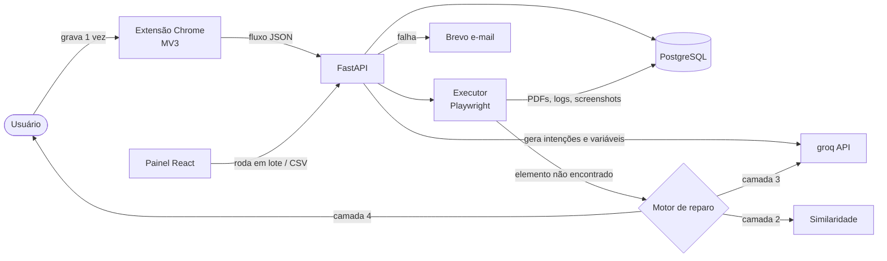

# 🪞 Imita

**Um agente que aprende tarefas repetitivas do navegador observando você uma única vez, e que continua funcionando quando o site muda.**


---

## 📌 O problema

Todo mês alguém do financeiro, RH ou administrativo passa horas fazendo a mesma sequência de cliques em portais de fornecedores, sistemas internos e sites de governo: filtrar, gerar relatório, baixar PDF, renomear, salvar na pasta certa. De novo, para cada loja, cliente ou funcionário.

As soluções que existem hoje caem em dois extremos:

| Abordagem | Problema |
|---|---|
| **RPA tradicional** (Selenium gravado, UiPath, Playwright codegen) | Quebra quando um botão muda de lugar ou de ID |
| **Agente 100% IA** (LLM navegando sozinho) | Lento, caro e imprevisível |

O **Imita** fica no meio: execução **determinística e rápida** quando nada mudou, com **IA entrando só quando algo quebra**.

---

## ⚙️ Como funciona

```
  1. GRAVAR            2. ENTENDER              3. EXECUTAR + AUTO-REPARO
  ─────────            ───────────              ─────────────────────────
  Você faz a tarefa    O LLM analisa a          Repete o fluxo em lote.
  uma vez. A extensão  gravação e gera:         Se um elemento sumir:
  captura cada passo   • intenção do passo        camada 1 → seletores salvos
  com uma "impressão   • pós-condição             camada 2 → similaridade
  digital" completa    • variáveis (CNPJ, mês)    camada 3 → LLM + verificação
  do elemento.                                    camada 4 → pede ajuda humana
```

Quando um reparo funciona, o novo caminho é salvo. O LLM é chamado **uma vez** por mudança no site, e as execuções seguintes voltam a ser rápidas e gratuitas.

---

## 🧪 Exemplo real

> Relatórios mensais de **25 lojas** no portal de um fornecedor: filtrar loja → selecionar mês → gerar → exportar PDF → renomear.

| | Manual | Imita |
|---|---|---|
| Tempo por mês | ~2 horas | **4 min 38 s** |
| Quando o portal mudou de layout | — | **1 reparo automático, 0 intervenções** |
| Erro humano (mês errado, arquivo trocado) | Acontece | Validado por pós-condição |

```
[01/25] Loja 01 - Shopping Norte
  passo 6: "Exportar o relatório gerado em PDF"
    ✘ camada 1: nenhum seletor salvo encontrou o elemento
    ✘ camada 2: melhor candidato = 0.41 (mínimo 0.75)
    ⟳ camada 3: consultando LLM com a intenção do passo...
      → "O botão foi movido para o menu 'Ações'. Plano: [Ações ▾] → [Baixar como PDF]"
    ✔ pós-condição OK: download de .pdf detectado
    💾 novo caminho salvo
[02/25] Loja 02 - Aldeota   ✔ 10s (usando caminho reparado)
...
✔ 25/25 concluídas | 1 reparo (camada 3) | 0 intervenções
```

---

## 🧰 Stack

### Backend
| Tecnologia | Uso no projeto |
|---|---|
| **Python 3.11** | Linguagem principal |
| **FastAPI** + **Uvicorn** | API REST (fluxos, execuções, logs, autenticação) |
| **SQLAlchemy 2** | ORM |
| **PostgreSQL** (psycopg) | Fluxos gravados, histórico de execuções e reparos |
| **Pydantic v2** + pydantic-settings | Validação dos fluxos e configuração por ambiente |
| **Playwright (Python)** | Motor de execução dos fluxos no navegador |
| **pandas** + **openpyxl** | Entrada em lote via CSV/Excel e exportação de resultados |
| **ReportLab** | Relatório em PDF de cada execução em lote |
| **Brevo API** | Alertas por e-mail quando um fluxo falha ou precisa de ajuda |
| **API do groq (openAI)** | Geração de intenções, pós-condições e auto-reparo (camada 3) |

### Frontend (painel)
| Tecnologia | Uso no projeto |
|---|---|
| **React 19** + **Vite 8** | Painel para listar, rodar e acompanhar fluxos |
| **Tailwind CSS 4** | Estilização |
| **React Router 7** | Navegação |
| **lucide-react** | Ícones |
| **oxlint** | Lint |

### Extensão gravadora
| Tecnologia | Uso no projeto |
|---|---|
| **Chrome Extension (Manifest V3)** | Captura de cliques, digitação, navegação e downloads |
| **JavaScript** | Content script + service worker |

### Segurança
| Tecnologia | Uso no projeto |
|---|---|
| **JWT** (python-jose) + **bcrypt** | Autenticação do painel |
| **Fernet / MultiFernet** (cryptography) | Credenciais dos portais criptografadas no banco, com rotação de chave |
| **Rate limiting** | Proteção das rotas expostas |

### Infra
| Tecnologia | Uso no projeto |
|---|---|
| **Docker** | Backend + executor Playwright em container |
| **Railway** | Deploy do backend, banco e painel |

---

## 🏗️ Arquitetura



---

## 📁 Estrutura

```
Ditto/
├── extension/                 # Extensão Chrome (gravador)
│   ├── manifest.json
│   ├── content.js             # captura eventos e impressão digital do elemento
│   └── background.js          # envia o fluxo para a API
├── backend/
│   ├── main.py
│   ├── app/
│   │   ├── api/v1/endpoints/  # fluxos, execuções, auth
│   │   ├── models/            # Fluxo, Passo, Execucao, Reparo, Usuario
│   │   ├── schemas/           # Pydantic
│   │   ├── core/              # config, database, security, encryption, rate_limit
│   │   └── services/
│   │       ├── executor.py    # roda o fluxo com Playwright
│   │       ├── matcher.py     # camada 2: pontuação por similaridade
│   │       ├── reparo_llm.py  # camada 3: reparo com LLM + verificação
│   │       ├── analisador.py  # intenções, pós-condições e variáveis
│   │       ├── lote.py        # entrada CSV/Excel com pandas
│   │       ├── relatorio_pdf.py
│   │       └── email_service.py
│   ├── requirements.txt
│   └── Dockerfile
├── frontend/                  # Painel React + Vite + Tailwind
└── site-de-teste/             # Portal falso que muda de layout a cada carregamento
```

---

## 📄 Como um passo fica salvo

```json
{
  "id": 6,
  "acao": "click",
  "intencao": "Exportar o relatório gerado em PDF",
  "alvo": {
    "role": "button",
    "texto": "Exportar PDF",
    "css": "#rel-actions > button:nth-child(2)",
    "vizinhos": ["Imprimir", "Exportar Excel"],
    "posicao_relativa": "abaixo da tabela de resultados"
  },
  "pos_condicao": { "tipo": "download", "extensao": "pdf" },
  "salvar_como": "relatorios/{mes}/{loja}.pdf"
}
```

Guardar **vários seletores** por elemento é o que permite sobreviver a IDs aleatórios, textos alterados e botões movidos.

---

## 🚀 Rodando localmente

```bash
# Backend
cd backend
python -m venv .venv && source .venv/bin/activate
pip install -r requirements.txt
playwright install chromium
cp .env.example .env        # DATABASE_URL, SECRET_KEY, ENCRYPTION_KEY, ANTHROPIC_API_KEY, BREVO_API_KEY
uvicorn main:app --reload

# Painel
cd frontend
npm install
npm run dev

# Extensão
# chrome://extensions → Modo do desenvolvedor → Carregar sem compactação → pasta extension/
```

---

## 🗺️ Roadmap

- [ ] **Fase 1 – Gravador:** extensão captura cliques, digitação e navegação e exporta JSON
- [ ] **Fase 2 – Replay:** executor Playwright com esperas inteligentes (sem `sleep`)
- [ ] **Fase 3 – Impressão digital:** múltiplos seletores e pontuação por similaridade
- [ ] **Fase 4 – IA:** intenções, pós-condições e auto-reparo com verificação
- [ ] **Fase 5 – Lote:** variáveis, entrada por CSV/Excel e agendamento
- [ ] **Fase 6 – Observabilidade:** painel com histórico, screenshots por passo e taxa de reparo por camada
- [ ] **Benchmark:** 100 variações de layout no site de teste, comparando com RPA tradicional

---

## 🔒 Segurança e uso responsável

- **Senhas nunca vão para o LLM.** Campos sensíveis são mascarados na gravação e as credenciais ficam criptografadas (Fernet) no banco.
- **Ações irreversíveis** (enviar, pagar, confirmar) pedem confirmação humana por padrão.
- **CAPTCHA:** o agente pausa e chama o humano. Ele não tenta contornar.
- Feito para automatizar **o seu próprio trabalho**, respeitando os termos de uso dos sistemas acessados.

---

## 👤 Autor

Feito por **[Seu Nome]** · [LinkedIn](https://www.linkedin.com/in/seu-perfil) · [GitHub](https://github.com/seu-usuario)

## 📝 Licença

MIT
