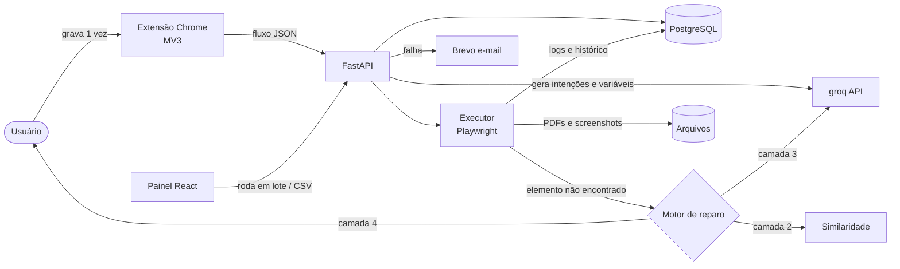

# 🪞 Ditto

**Automatize praticamente qualquer tarefa repetitiva do navegador: você faz uma vez, o Ditto repete quantas vezes precisar, e continua funcionando quando o site muda.**

Se a tarefa é feita com cliques, digitação, escolhas em listas, navegação entre páginas e downloads, o Ditto consegue gravar e repetir. Funciona em portais de fornecedores, sistemas internos, sites de prefeitura e de governo, bancos, ERPs na web e qualquer outro site que você já usa no Chrome.


---

## 📌 O problema

Todo mês alguém do financeiro, RH ou administrativo passa horas fazendo a mesma sequência de cliques em portais de fornecedores, sistemas internos e sites de governo: filtrar, gerar relatório, baixar PDF, renomear, salvar na pasta certa. De novo, para cada loja, cliente ou funcionário.

As soluções que existem hoje caem em dois extremos:

| Abordagem | Problema |
|---|---|
| **RPA tradicional** (Selenium gravado, UiPath, Playwright codegen) | Quebra quando um botão muda de lugar ou de ID |
| **Agente 100% IA** (LLM navegando sozinho) | Lento, caro e imprevisível |

O **Ditto** fica no meio: execução **determinística e rápida** quando nada mudou, com **IA entrando só quando algo quebra**.

---

## 🧩 O que dá para automatizar

O Ditto não é feito para um site ou uma tarefa específica. Ele aprende **qualquer sequência de ações no navegador** e repete para cada linha de uma planilha (loja, cliente, CNPJ, funcionário, mês).

| Tipo de tarefa | Exemplos |
|---|---|
| **Baixar arquivos em lote** | Relatório mensal de cada loja, XMLs de NF-e do portal do fornecedor, extratos, comprovantes, boletos |
| **Emitir documentos** | Guia de ISS no portal da prefeitura, segunda via de boletos, certidões negativas, notas fiscais de serviço |
| **Preencher formulários repetidos** | Cadastro de clientes ou produtos a partir de uma planilha, abertura de chamados, solicitações em sistemas internos |
| **Passar dados entre sistemas** | Lançar boletos conferidos na planilha, passar o ponto dos diaristas para o Excel, copiar pedidos de um portal para o ERP |
| **Consultar e conferir** | Status de pedidos, situação de CNPJs, saldo e vencimentos em vários portais, todo dia ou toda semana |
| **Rotinas agendadas** | Tudo acima rodando sozinho no dia e horário certos, como "todo dia 5 às 07:10" |

**O que o Ditto faz em cada passo:** clicar, digitar, escolher opções em listas, navegar entre páginas, esperar carregamentos, baixar arquivos, salvar com o nome e a pasta certos e **ler dados da tela**. O que ele lê vai para um Excel, e pode ser digitado em outro sistema no mesmo fluxo.

**Onde ele para e chama você:** CAPTCHA, ações que não têm volta (pagar, enviar, confirmar) e qualquer passo em que ele não tenha certeza do que fazer. Veja [Segurança e uso responsável](#-segurança-e-uso-responsável).

---

## ⚙️ Como funciona

```
  1. GRAVAR            2. ENTENDER              3. EXECUTAR + AUTO-REPARO
  ─────────            ───────────              ─────────────────────────
  Você faz a tarefa    O LLM analisa a          Repete o fluxo em lote.
  uma vez. A extensão  gravação e gera:         Se um elemento sumir:
  captura cada passo   • intenção do passo        camada 1 → seletores salvos
  com uma "impressão   • pós-condição             camada 2 → similaridade
  digital" completa    • variáveis (CNPJ, mês)    camada 3 → LLM + verificação
  do elemento.                                    camada 4 → pede ajuda humana
```

Quando um reparo funciona, o novo caminho é salvo. O LLM é chamado **uma vez** por mudança no site, e as execuções seguintes voltam a ser rápidas e gratuitas.

---

## 🧪 Exemplo real

> Relatórios mensais de **25 lojas** no portal de um fornecedor: filtrar loja → selecionar mês → gerar → exportar PDF → renomear.

| | Manual | Ditto |
|---|---|---|
| Tempo por mês | ~2 horas | **4 min 38 s** |
| Quando o portal mudou de layout | — | **1 reparo automático, 0 intervenções** |
| Erro humano (mês errado, arquivo trocado) | Acontece | Validado por pós-condição |

```
[01/25] Loja 01 - Shopping Norte
  passo 6: "Exportar o relatório gerado em PDF"
    ✘ camada 1: nenhum seletor salvo encontrou o elemento
    ✘ camada 2: melhor candidato = 0.41 (mínimo 0.75)
    ⟳ camada 3: consultando LLM com a intenção do passo...
      → "O botão foi movido para o menu 'Ações'. Plano: [Ações ▾] → [Baixar como PDF]"
    ✔ pós-condição OK: download de .pdf detectado
    💾 novo caminho salvo
[02/25] Loja 02 - Aldeota   ✔ 10s (usando caminho reparado)
...
✔ 25/25 concluídas | 1 reparo (camada 3) | 0 intervenções
```

---

## 🧰 Stack

### Backend
| Tecnologia | Uso no projeto |
|---|---|
| **Python 3.12** | Linguagem principal |
| **FastAPI** + **Uvicorn** | API REST (fluxos, execuções, logs, autenticação) |
| **SQLAlchemy 2** | ORM |
| **PostgreSQL** (psycopg) | Fluxos gravados, histórico de execuções e reparos |
| **Alembic** | Migrações do banco |
| **Pydantic v2** + pydantic-settings | Validação dos fluxos e configuração por ambiente |
| **Playwright (Python)** | Motor de execução dos fluxos no navegador |
| **openpyxl** | Entrada em lote via Excel. CSV é lido pela biblioteca padrão, para não perder zeros à esquerda |
| **croniter** | Agendamento das tarefas |
| **ReportLab** | Relatório em PDF de cada execução em lote |
| **Brevo API** | Alertas por e-mail quando um fluxo falha ou precisa de ajuda |
| **API do groq (openAI)** | Geração de intenções e auto-reparo (camada 3). Opcional: sem chave, o Ditto segue com regras e pedidos de ajuda |

### Frontend (painel)
| Tecnologia | Uso no projeto |
|---|---|
| **React 19** + **Vite 8** | Painel para listar, rodar e acompanhar fluxos |
| **Tailwind CSS 4** | Estilização |
| **React Router 7** | Navegação |
| **lucide-react** | Ícones |
| **oxlint** | Lint |

### Extensão gravadora
| Tecnologia | Uso no projeto |
|---|---|
| **Chrome Extension (Manifest V3)** | Grava cliques, digitação, navegação e downloads, e captura dados da tela |
| **JavaScript** | Content script + service worker, sem etapa de build |

### Segurança
| Tecnologia | Uso no projeto |
|---|---|
| **JWT** (PyJWT) + **bcrypt** | Autenticação do painel |
| **Proxy de saída** | Todo o tráfego do navegador passa por ele, e nada chega à rede interna |
| **Fernet / MultiFernet** (cryptography) | Credenciais dos portais criptografadas no banco, com rotação de chave |
| **Rate limiting** | Proteção das rotas expostas |

### Infra
| Tecnologia | Uso no projeto |
|---|---|
| **Docker** | Backend + executor Playwright em container |
| **Railway** | Deploy do backend, banco e painel |

---

## 🏗️ Arquitetura

> Backend e painel estão implementados. A extensão ainda não existe: por enquanto, as gravações entram por um arquivo JSON importado no painel. Os detalhes estão no [README do backend](backend/README.md), e o resumo visual em [docs/ditto-implantado.png](docs/ditto-implantado.png).



---

## 📁 Estrutura

```
Ditto/
├── backend/                   # API, worker e motor de execução (veja backend/README.md)
│   ├── alembic/               # migrações do banco
│   ├── tests/                 # com PostgreSQL e Chromium de verdade
│   └── app/
│       ├── main.py            # a API
│       ├── worker.py          # o processo que tira as cópias
│       ├── controllers/
│       ├── models/
│       ├── schemas/
│       ├── repositories/
│       ├── core/              # config, database, exceptions, security, encryption, rate_limit
│       └── services/
│           ├── engine/        # navegador, proxy de saída e a escada de reparo
│           └── ...
├── frontend/                  # Landing page e painel (React + Vite + Tailwind)
│   └── src/features/          # auth, conta, dashboard, fluxos, execucoes, reparos
├── extension/                 # Gravador para o Chrome (veja extension/README.md)
└── docs/
```

---

## 📄 Como um passo fica salvo

```json
{
  "position": 6,
  "action": "click",
  "intent": "Exportar o relatório gerado em PDF",
  "target": {
    "role": "button",
    "text": "Exportar PDF",
    "css": "#rel-actions > button:nth-child(2)",
    "neighbors": ["Imprimir", "Exportar Excel"],
    "relative_position": "abaixo da tabela de resultados"
  },
  "postcondition": { "type": "download", "extension": "pdf" },
  "save_as": "relatorios/{mes}/{loja}.pdf"
}
```

Guardar **vários seletores** por elemento é o que permite sobreviver a IDs aleatórios, textos alterados e botões movidos.

---

## 🚀 Rodando localmente

```bash
# Backend (no Linux/macOS, ative com: source .venv/bin/activate)
cd backend
python -m venv .venv
.venv\Scripts\activate
python -m pip install -r requirements-dev.txt
python -m playwright install chromium
copy .env.example .env      # depois preencha os valores: as instruções estão no arquivo
createdb -U postgres ditto
python -m alembic upgrade head

# São dois processos, cada um em um terminal:
python -m uvicorn app.main:app --reload   # a API, em http://localhost:8000/docs
python -m app.worker                      # quem analisa as gravações e tira as cópias

# Painel
cd frontend
npm install
npm run dev                  # em http://localhost:5173
```

Para gravar, carregue o gravador no Chrome: em `chrome://extensions`, ligue o **Modo do desenvolvedor**, clique em **Carregar sem compactação** e escolha a pasta `extension/`.

---

## 🗺️ Roadmap

- [x] **Landing page:** apresentação do produto com uma demo interativa do auto-reparo (simulada no navegador)
- [x] **Fase 1 – Gravador:** extensão do Chrome grava cliques, digitação, navegação e downloads, e captura dados da tela. Testada no Chrome, em sites públicos de demonstração; falta usar em portais de trabalho
- [x] **Fase 2 – Replay:** executor Playwright com esperas inteligentes (sem `sleep`)
- [x] **Fase 3 – Impressão digital:** múltiplos seletores e pontuação por similaridade
- [x] **Fase 4 – IA:** intenções, pós-condições e auto-reparo com verificação. Testado contra o Groq no portal de teste; falta medir em sites reais
- [x] **Fase 5 – Lote:** variáveis, entrada por CSV/Excel e agendamento
- [x] **Fase 6 – Observabilidade:** painel com histórico, screenshots e taxa de reparo por camada
- [ ] **Benchmark:** 100 variações de layout no site de teste, comparando com RPA tradicional
- [ ] **Grandes volumes:** vários workers, lotes acima de 500 linhas e medição de carga
- [ ] **Mais lógica no fluxo:** repetir para cada linha de uma tabela do site e seguir por condições

---

## 🔒 Segurança e uso responsável

- **Senhas nunca vão para o LLM.** Campos sensíveis são mascarados na gravação e as credenciais ficam criptografadas (Fernet) no banco.
- **Ações irreversíveis** (enviar, pagar, confirmar) pedem confirmação humana por padrão.
- **CAPTCHA:** o agente pausa e chama o humano. Ele não tenta contornar.
- Feito para automatizar **o seu próprio trabalho**, respeitando os termos de uso dos sistemas acessados.

---

## 👤 Autor

Feito por **Iarley Marques** · [LinkedIn](https://www.linkedin.com/in/iarley-marques23) · [GitHub](https://github.com/iarleymarques55-design) · iarleymarques672@gmail.com

## 💡 Por que "Ditto"

O nome vem da *ditto machine*, o mimeógrafo: você prepara uma **matriz** uma vez e tira quantas **cópias** precisar. No Ditto, a gravação é a matriz e cada execução é uma cópia.

## 📝 Licença

MIT
