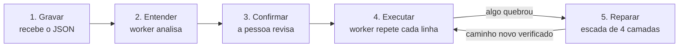
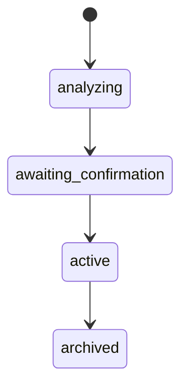
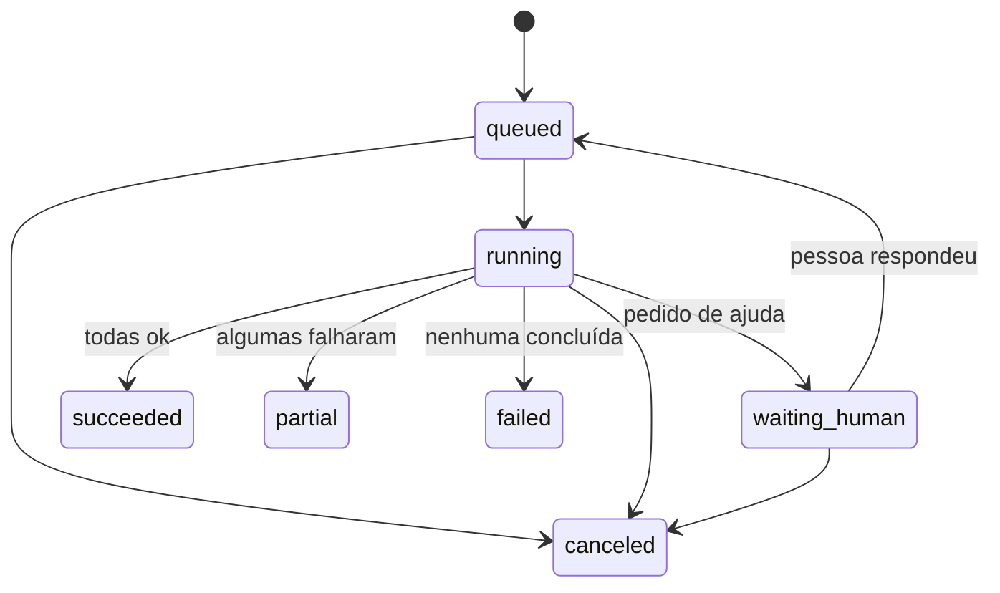

# Ditto: backend

API e motor de execução do Ditto. O backend guarda as tarefas gravadas no navegador, repete cada uma para todas as linhas de uma planilha e, quando o site muda, tenta se adaptar sozinho antes de pedir ajuda.

Para a visão do produto, veja o [README principal](../README.md).

> **Estado atual:** implementado e testado. As gravações chegam pela [extensão do Chrome](../extension/README.md), que também captura dados da tela ([formato](#formato-da-gravação)).
>
> **Testado contra o serviço real:** Groq, com o modelo `openai/gpt-oss-120b`.
>
> **Ainda sem teste contra o serviço real:** Brevo e login com Google. O comportamento foi testado só com respostas simuladas.

## Rodando localmente

Requer Python 3.12 e PostgreSQL. Os comandos são para Windows; no Linux/macOS, ative com `source .venv/bin/activate` e copie com `cp`.

```bash
cd backend
python -m venv .venv
.venv\Scripts\activate
python -m pip install -r requirements-dev.txt
python -m playwright install chromium
copy .env.example .env          # depois preencha os valores: as instruções estão no arquivo
createdb -U postgres ditto
python -m alembic upgrade head
```

São **dois processos**, e os dois precisam estar no ar:

```bash
python -m uvicorn app.main:app --reload   # a API, em http://localhost:8000/docs
python -m app.worker                      # quem analisa as gravações e tira as cópias
```

Sem o worker, a API funciona, mas as gravações ficam em análise e as execuções ficam na fila.

```bash
createdb -U postgres ditto_test   # banco só dos testes: é apagado a cada execução
python -m pytest                  # testes, com PostgreSQL e Chromium de verdade
python -m ruff check .            # lint e regras de segurança
```

## A ideia central

Um robô de gravação comum quebra quando um botão muda de lugar. Um agente de IA navegando sozinho é lento, caro e imprevisível. O Ditto combina os dois:

- **Quando nada mudou**, repete os passos gravados, sem IA e sem custo por execução.
- **Quando algo quebra**, sobe uma escada de reparo, da opção mais barata para a mais cara.
- **Nenhum passo é dado como concluído só porque o clique funcionou.** Cada passo tem uma pós-condição, como "um PDF foi baixado", que precisa ser verdadeira.
- **Quando um reparo funciona**, o novo caminho é salvo e as próximas execuções não precisam mais da IA.

## Vocabulário

| Termo | No código | O que é |
|---|---|---|
| Tarefa | `Flow` | O que foi gravado, a "matriz" de onde saem as cópias |
| Passo | `Step` | Uma ação: abrir, clicar, digitar, escolher, marcar ou pressionar |
| Impressão digital | `target` | O que identifica o elemento: papel, texto, rótulo, CSS e vizinhos |
| Versão | `StepVersion` | Um caminho conhecido para o passo. Cada reparo cria uma nova |
| Variável | `Variable` | O que muda a cada repetição, como loja ou mês |
| Execução | `Run` | Um disparo da tarefa, à mão ou pela agenda |
| Linha | `RunItem` | Uma linha da planilha dentro da execução: uma "cópia" |
| Reparo | `Repair` | O registro de um caminho novo encontrado |
| Pedido de ajuda | `HelpRequest` | Uma pausa que espera a decisão de uma pessoa |

## Como a lógica funciona



### 1. Gravar

A [extensão](../extension/README.md) observa a tarefa e envia para `POST /api/v1/flows` os passos com a impressão digital de cada elemento. Ela usa um token próprio, pedido em `POST /auth/recording-token`: dura 2 horas e só serve para essa rota. O backend não confia no envio: valor de campo de senha é descartado, e o campo de texto logo antes dele é tratado como usuário de login. Os dois passam a usar uma credencial salva.

### 2. Entender

O worker pega a gravação e define, para cada passo:

- a **intenção**: "Exportar o relatório em PDF";
- a **pós-condição**: um download, o valor no campo ou a página ter mudado;
- se ele **não tem volta**, por palavras como "pagar" ou "enviar" no botão;
- as **variáveis**: cada valor digitado vira uma pergunta. Valores como `09/2026` já são sugeridos como "sempre o mês anterior".

Com o LLM configurado, ele melhora as intenções. Ele recebe o formato do valor (`Loja 07` vira `aaaa 99`), nunca o conteúdo, e só pode pedir mais cautela, nunca menos. Sem chave ou se ele falhar, ficam as regras simples.

### 3. Confirmar

A tarefa fica em `awaiting_confirmation` até a pessoa responder cada pergunta no painel e ativar.



### 4. Executar

A API nunca abre navegador. `POST /api/v1/runs` lê a planilha, cria uma linha para cada uma e responde na hora. O worker faz o resto:

```text
para cada linha da execução:
    abrir um contexto de navegador limpo
    para cada passo da tarefa:
        se não tem volta e não foi autorizado: abrir pedido de confirmação e parar
        subir a escada de reparo até o passo dar certo
    salvar arquivos, registrar o tempo e marcar a linha como concluída
```

Regras da execução:

- **Sem `sleep`.** O motor espera eventos do Playwright e a pós-condição, com tempo limite.
- **A falha de uma linha não derruba o lote.** Valor que não existe no portal é dado errado, não layout novo: a linha falha e a próxima começa.
- **Disjuntor:** 3 linhas seguidas com falha param a execução, para não bloquear a conta no portal com tentativas de login erradas.
- **Um reparo vale para o resto do lote.** Se a loja 01 achou o caminho novo, as outras já o usam.

### Ler dados da tela

Um passo `capture` lê um valor ou uma tabela e guarda no resultado da linha (`RunItem.output`). O valor vai para uma coluna do Excel, e pode ser digitado em um passo seguinte, como copiar a situação de um portal para o ERP. Cada tabela ganha uma aba própria.

O dado é localizado pelo **rótulo** que fica perto dele ("Situação", o cabeçalho da coluna), nunca pelo próprio valor, que muda a cada linha. Por isso a captura não usa as camadas 2 e 3: um dado errado passaria despercebido, então, se o rótulo sumir, o Ditto para e pede ajuda. Senhas e cartões nunca são lidos, e uma senha salva que apareça na tela é apagada do resultado.

### 5. Reparar: a escada de 4 camadas

| Camada | O que faz | Custo | Sai com sucesso quando |
|---|---|---|---|
| 1. Seletores salvos | Tenta papel + nome, rótulo, texto e, por último, CSS, em todas as versões conhecidas | Grátis | Acha **exatamente um** elemento visível e a pós-condição passa |
| 2. Similaridade | Dá uma nota a cada elemento comparando com a impressão digital | Grátis | Nota ≥ 0,75, com folga de 0,05 sobre o segundo, e a pós-condição passa |
| 3. LLM | Envia a intenção e a lista sanitizada de elementos, e recebe qual usar | Pago | O elemento é válido e a pós-condição passa |
| 4. Pessoa | Para, avisa por e-mail e mostra no painel | Tempo de alguém | A pessoa decide |

O que protege essa escada:

1. **A pós-condição decide.** Um caminho só é salvo depois que ela passa. Se o LLM errar, nada é gravado e a execução sobe para a camada 4.
2. **Passo sem volta não é reparado sozinho.** Ele pula as camadas 2 e 3 e vai direto para a pessoa.
3. **Uma linha que tocou em um passo sem volta nunca recomeça**, nem depois de uma queda do worker. A marca é salva antes do clique.
4. **O conteúdo da página não é confiável.** Um site pode trazer um texto escrito para enganar a IA. Por isso, o LLM só escolhe um elemento da lista: não inventa seletor, URL nem script. Elemento com cara de "apagar" ou "pagar" é recusado se o passo não era esse.
5. **CSS antigo não basta.** Um seletor frágil que agora aponta para um botão com outro texto não é clicado.
6. **Reparo não apaga o passado.** Cada caminho vira uma versão, e as antigas continuam sendo tentadas, caso o site volte ao layout anterior.
7. **O gasto com IA tem limite.** São no máximo 5 chamadas por execução.
8. **CAPTCHA:** o Ditto para e chama uma pessoa. Não tenta contornar.

### Estados da execução



Enquanto espera uma pessoa, a execução **não segura navegador nem worker**: ela volta para a fila depois da resposta e a linha recomeça do início. Por isso, um pedido pode esperar até 72 horas sem custo. Sem resposta nesse prazo, a linha falha e o lote segue.

## Fila e agendamento

A fila é o próprio PostgreSQL, sem Redis ou Celery. O volume inicial não justifica mais uma peça para operar.

- O worker busca trabalho com `SELECT ... FOR UPDATE SKIP LOCKED`: dois workers nunca pegam a mesma execução. Para mais vazão, suba mais workers.
- Enquanto roda, ele atualiza `heartbeat_at`. Uma execução sem sinal há 5 minutos volta para a fila, sem refazer as linhas prontas.
- Agendas ficam em `schedules`, com a planilha salva. Horários perdidos durante uma pausa não disparam depois.
- O painel acompanha o progresso consultando a API periodicamente.

## Banco de dados

São 14 tabelas. Toda tabela tem `id` (UUID), `created_at` e `updated_at`.

| Tabela | Para quê |
|---|---|
| `users` | Contas, com senha em bcrypt ou vínculo com o Google |
| `flows`, `steps`, `step_versions`, `variables` | A tarefa, seus passos, os caminhos conhecidos e o que muda a cada cópia |
| `credentials` | Acesso aos portais, cifrado com Fernet |
| `schedules` | Agendas, com a planilha que cada disparo repete |
| `runs`, `run_items` | Execuções e suas linhas |
| `step_events`, `run_log_entries` | O que aconteceu em cada passo e o registro mostrado no painel |
| `artifacts` | Metadados de arquivos e screenshots. O conteúdo fica em `STORAGE_DIR`, não no banco |
| `repairs`, `help_requests` | Histórico de reparos e decisões que esperam uma pessoa |

## API

Todas as rotas ficam em `/api/v1` e estão documentadas em `/docs`, que só abre em desenvolvimento. Exceto `health` e as de autenticação, todas exigem JWT e só enxergam recursos da própria conta: recurso de outra pessoa responde `404`.

| Rotas | O que fazem |
|---|---|
| `POST /auth/register`, `/auth/login`, `/auth/google`, `GET /auth/me` | Conta e login |
| `POST /auth/recording-token` | Token curto para a extensão enviar uma gravação |
| `PATCH`, `DELETE /account`, `POST /account/password` | Nome, avisos por e-mail, senha e exclusão da conta |
| `GET`, `PUT`, `DELETE /account/avatar` | Foto de perfil |
| `GET /dashboard/summary` | Resumo do dia para a Mesa |
| `GET`, `POST /flows`, `GET`, `PATCH`, `DELETE /flows/{id}` | Tarefas |
| `PATCH /flows/{id}/steps/{id}` | Editar intenção, "não tem volta" e onde salvar |
| `POST /flows/{id}/variables/{id}/answer`, `POST /flows/{id}/confirm` | Responder perguntas e ativar |
| `GET`, `POST /runs`, `GET /runs/{id}`, `POST /runs/{id}/cancel` | Execuções, com CSV ou Excel |
| `GET /runs/{id}/report`, `/runs/{id}/export?format=csv\|xlsx`, `GET /artifacts/{id}` | PDF, CSV, Excel e arquivos gerados |
| `GET /runs/{id}/items/{id}/output` | Dados capturados em uma linha, com as tabelas inteiras |
| `GET /repairs`, `/repairs/stats` | Histórico e passos por camada |
| `GET /help-requests`, `POST /help-requests/{id}/answer` | Pedidos de ajuda |
| `GET`, `POST /credentials`, `DELETE /credentials/{id}` | Acessos; a senha nunca volta na resposta |
| `GET`, `POST /schedules`, `PATCH`, `DELETE /schedules/{id}` | Agendas |

Os erros têm sempre o mesmo formato, e erros de validação nunca devolvem o valor enviado:

```json
{ "detail": "Recurso não encontrado.", "code": "NOT_FOUND" }
```

## Formato da gravação

É o que a extensão envia.

```json
{
  "name": "Relatório mensal por loja",
  "start_url": "https://portal.fornecedor.com/relatorios",
  "allowed_hosts": ["portal.fornecedor.com", "login.fornecedor.com"],
  "steps": [
    { "action": "navigate", "url": "https://portal.fornecedor.com/relatorios" },
    {
      "action": "select",
      "value": "Loja 07 - Centro",
      "target": { "role": "combobox", "label": "Loja", "name": "loja", "css": "#loja" }
    },
    {
      "action": "click",
      "target": { "role": "button", "text": "Exportar PDF", "neighbors": ["Imprimir", "Excel"] },
      "downloaded_extension": "pdf"
    },
    {
      "action": "capture",
      "capture_name": "Situação",
      "target": { "tag": "dd", "anchor": "Situação", "anchor_kind": "definition" }
    },
    {
      "action": "capture",
      "capture_name": "Notas",
      "capture_kind": "table",
      "target": { "tag": "table", "neighbors": ["Número", "Valor"], "css": "#notas" }
    },
    {
      "action": "fill",
      "value_from_capture": "Situação",
      "target": { "role": "textbox", "label": "Situação no ERP", "css": "#situacao" }
    }
  ]
}
```

`action` aceita `navigate`, `click`, `fill`, `select`, `check`, `press` e `capture`. O campo `target` aceita `role`, `tag`, `text`, `label`, `placeholder`, `name`, `test_id`, `anchor`, `anchor_kind`, `row_index`, `css`, `input_type`, `autocomplete`, `neighbors` e `relative_position`.

`anchor_kind` diz como o dado se liga ao rótulo: `table_header`, `definition`, `label`, `inline` ou `adjacent`. `value_from_capture` só aceita uma captura de valor feita antes do passo.

## Segurança

Um servidor que abre sites a pedido do usuário, usando senhas de terceiros, é o maior risco deste projeto. Cada regra abaixo tem teste em [tests/](tests/).

| Risco | Regra |
|---|---|
| Senha chegar ao LLM | Um único [sanitizador](app/services/sanitizer.py) monta tudo o que vai para a IA. O valor dos campos nem é coletado da página, e os valores protegidos são removidos do texto. Uma trava final cancela a chamada se algo escapar |
| Senha vazar em banco ou log | Credenciais cifradas com `MultiFernet`, com rotação de chave. Só o worker lê, em memória, na hora de preencher |
| Dados sensíveis em screenshot | Campos de senha saem cobertos, o acesso é só do dono e os arquivos são apagados em 30 dias |
| Worker usado para atacar a rede interna (SSRF) | Todo o tráfego do navegador passa por um [proxy de saída](app/services/engine/egress_proxy.py), que confere o IP de destino ao conectar. Cobre redirecionamentos, WebSocket e DNS rebinding |
| Navegar para fora da tarefa | Cada tarefa só navega nos seus domínios, e o endereço final é conferido depois de redirecionamentos |
| Uma execução enxergar a de outra pessoa | Contexto de navegador novo por linha |
| Acesso a recurso de outro usuário | Filtro por `owner_id` em toda consulta |
| Planilha criar caminho malicioso | Valores nunca criam pastas: `../` vira parte de um único nome de arquivo |
| Upload abusivo ou fórmula em planilha | Limite de 5 MB e 500 linhas. Células exportadas que começam com `=`, `+`, `-` ou `@` são neutralizadas |
| Conta criada com o e-mail de outra pessoa | O cadastro não confirma o e-mail. Ao entrar com Google, a senha antiga da conta é apagada |
| Força bruta | Limite de tentativas por IP e por conta. O limite é por processo: com várias instâncias da API, cada uma conta as suas |
| Sessão roubada | Trocar a senha invalida todos os tokens anteriores |
| Foto maliciosa | A imagem é decodificada e regravada em 256x256. O arquivo enviado e os metadados, como a localização, não ficam guardados |
| Token da extensão vazar | Dura 2 horas e só envia gravações: não lê tarefas, conta nem acessos, e não gera outro token |
| Extensão gravar o que não devia | Só age nas abas iniciadas pelo painel e nas janelas abertas por elas. O valor de senha, cartão e código nunca é lido, e eventos falsos criados pela página são ignorados |
| Página mexer na gravação | A barra fica em um shadow DOM fechado e só aceita clique real. O texto do site nunca vira HTML, e fora do painel não existe ponte com a extensão |
| Dado capturado virar ataque | Fórmulas são neutralizadas no Excel e no CSV. O dado capturado usado em um passo seguinte é só texto |

## Onde cada coisa fica

Cada camada só conversa com a de baixo: `Controller` (recebe e responde), `Service` (regra de negócio), `Repository` (banco).

```text
backend/
├── alembic/
├── tests/
│   ├── fixtures/portal.py      # portal falso que muda de layout
│   └── security/
└── app/
    ├── main.py
    ├── worker.py               # o processo que tira as cópias
    ├── core/                   # config, database, exceptions, security, encryption, rate_limit
    ├── controllers/
    ├── models/
    ├── schemas/
    ├── repositories/
    └── services/
        ├── engine/
        │   ├── browser.py       # abre o navegador protegido
        │   ├── egress_proxy.py  # confere o destino de cada conexão
        │   ├── executor.py      # sobe a escada de reparo
        │   ├── locator.py       # camada 1
        │   ├── matcher.py       # camada 2
        │   ├── llm_repair.py    # camada 3
        │   ├── postcondition.py
        │   ├── safety.py
        │   └── snapshot.py
        ├── run_processor.py     # liga o motor ao banco
        ├── run_lifecycle.py     # mudanças de estado da execução
        ├── worker_tasks.py      # o que o worker faz a cada volta
        ├── analyzer.py
        ├── sanitizer.py         # único caminho de saída para o LLM
        ├── batch.py             # leitura de CSV e Excel
        └── ...                  # um service por recurso
```

Ao criar um model, importe-o em [models/\_\_init\_\_.py](app/models/__init__.py) para o Alembic enxergá-lo.

## Configuração

Tudo vem do ambiente, lido em [config.py](app/core/config.py). Sem os segredos obrigatórios, a API não inicia. O [.env.example](.env.example) explica cada variável.

| Variável | Para quê | Obrigatória |
|---|---|---|
| `DATABASE_URL` | Conexão com o PostgreSQL | Sim |
| `JWT_SECRET` | Assinatura dos tokens, com pelo menos 32 caracteres | Sim |
| `FERNET_KEYS` | Chaves das credenciais, da mais nova para a mais antiga | Sim |
| `TEST_DATABASE_URL` | Banco dos testes | Só para testar |
| `ENVIRONMENT`, `CORS_ORIGINS` | Ambiente e origens permitidas | Não |
| `GOOGLE_CLIENT_ID` | Login com Google | Não |
| `LLM_API_KEY`, `LLM_MODEL`, `LLM_BASE_URL` | IA, por API compatível com OpenAI. Sem chave, a camada 3 é pulada | Não |
| `BREVO_API_KEY`, `EMAIL_FROM`, `PANEL_URL` | Alertas por e-mail. Sem chave, o aviso fica só no painel | Não |
| `STORAGE_DIR` | Onde ficam os arquivos gerados. Em produção, precisa ser um volume | Não |
| `BROWSER_HEADLESS` | Use `false` para ver o navegador repetindo a tarefa no seu computador | Não |

> Perder ou trocar `FERNET_KEYS` sem manter a chave antiga torna as senhas salvas ilegíveis.

## O que ainda falta

- **Sessão na repetição:** cada linha começa em um navegador limpo, sem a sua sessão. Quem grava já logado vê um aviso na repetição e precisa gravar de novo, começando pelo login. Código por e-mail ou SMS e login pelo Google não passam.
- **Grandes volumes:** o limite é de 500 linhas por execução, e cada execução roda uma linha de cada vez em um único worker. Ainda não foi medido com muitas execuções ao mesmo tempo.
- **Repetir para cada linha de uma tabela do site:** a repetição só vem da planilha enviada. A tabela é capturada, mas ainda não dá para clicar em cada linha dela.
- **Condições:** não há "se aparecer X, faça Y".
- **Envio de arquivo para o site:** a extensão avisa que não grava esse passo.
- **CAPTCHA e código de login:** no servidor, ninguém consegue interagir com a tela. Hoje a pessoa só pode tentar de novo ou pular a linha. Falta decidir entre transmitir a tela para o painel, reaproveitar uma sessão salva ou rodar um executor local.
- **Armazenamento:** os arquivos ficam em disco. Em produção, precisa de um volume ou de um bucket.
- **Recuperação de senha e confirmação de e-mail:** ainda não existem.
- **Iframes:** gravar, repetir e capturar funcionam dentro deles, mas as camadas 2 e 3 de reparo só olham a página principal.
- **Deploy:** não há Dockerfile ainda, e o proxy não substitui bloquear a saída para a rede interna no próprio ambiente.
- **Benchmark:** os pesos e o limiar da camada 2 são valores iniciais, sem calibração com sites reais.
